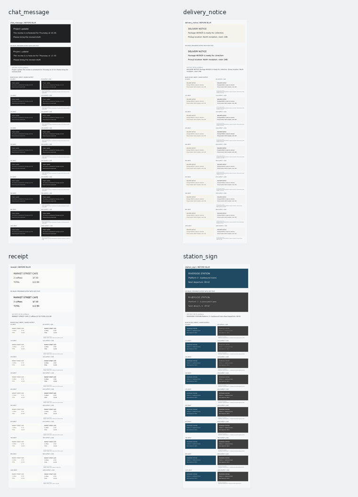

# Deblur Text Analyzer

A command-line OCR experiment for blurred text images. It creates denoising, sharpening, contrast, enlargement, and thresholding candidates before recognition with Tesseract. OCR candidates are ranked against the selected language profile and optional reference text.

## Before and After Samples

All demo images are synthetic and generated locally. No personal photographs are included. Each of the 40 blurred inputs has a corresponding saved output with OCR text and a side-by-side comparison.



The dataset contains four fictional text layouts at ten evenly spaced blur levels from `0%` through `100%` (approximately 11% between levels). Each sample board shows the original, unblurred text at the top; directly below it is the saved program output for the `0%` input with recognized text written underneath. The lower section compares all ten blurred inputs with their saved OCR-overlay outputs. Browse the [compact overview](assets/blur_samples/before_after_gallery.png) or the [individual sample boards](assets/blur_samples/); `metadata.json` contains each input, output, ground-truth text, OCR transcript, and blur amount.

The `*_program_output.png` images are produced by running the sample through Tesseract and the demo's denoise/sharpen preprocessing, then saving the selected image with OCR text below it. This is a preprocessing demonstration, not a promise that the text is perfectly restored or that details removed by blur can be reconstructed.

Regenerate the synthetic dataset and comparisons with:

```sh
python tools/generate_blur_samples.py
```

## Setup

### 1. Install system tools

The analyzer requires Tesseract OCR. Hunspell is used for spelling suggestions when dictionary suggestions are enabled in the model.

Debian or Ubuntu:

```sh
sudo apt update
sudo apt install tesseract-ocr hunspell
```

For Polish OCR, install the Polish Tesseract model as well:

```sh
sudo apt install tesseract-ocr-pol
```

Install the Tesseract model for the language you want to recognize. A language profile selected with `--language` does not install an OCR model; when its model is missing, OCR falls back to an installed model.

### 2. Create a Python environment

```sh
python -m venv .venv
source .venv/bin/activate
python -m pip install -r requirements.txt
```

On Windows PowerShell, activate the environment with:

```powershell
.venv\Scripts\Activate.ps1
```

### 3. Download dictionaries

With the virtual environment active and an internet connection, run:

```sh
python main.py --download-dictionaries
```

Dictionary files are cached outside the repository at `~/.cache/deblur/dictionaries`. The downloader supports the configured languages; spelling dictionaries and word lists come from upstream projects and retain their own licenses. Hunspell suggestions additionally require the `hunspell` system command.

## Usage

Analyze an image without saving a processed copy:

```sh
python main.py assets/blur_samples/chat_message_blur_056.png
```

Analyze an image and save the selected preprocessed image with recognized text below it:

```sh
python main.py assets/blur_samples/chat_message_blur_056.png output.png
```

Choose a language profile explicitly:

```sh
python main.py assets/blur_samples/chat_message_blur_056.png output.png --language eng
```

Write detailed OCR candidate scores and per-character scores to `debug.log`:

```sh
python main.py assets/blur_samples/chat_message_blur_056.png output.png --language eng --debug
```

The output path is optional. Without it, the CLI only prints its analysis. With it, the selected denoised/sharpened candidate plus an OCR transcript panel is saved as PNG, JPG, WEBP, TIFF, or BMP. The transcript reflects OCR recognition and may contain errors.

Language profiles, letter weights, reference text, and correction thresholds are configured in [`letter_model.json`](letter_model.json). Select another model with `--model path/to/model.json`.

## Limitations

- This is an OCR-analysis prototype, not an end-to-end trained deblurring model.
- OCR quality depends on blur severity, input quality, and installed Tesseract language models.
- If OCR confidence is too low and the reference text does not match strongly enough, the program reports the raw OCR and skips automatic correction rather than inventing text.
- Character percentages are OCR/model scores, not calibrated probabilities.
- Denoising and sharpening can improve some inputs, but cannot restore details completely removed by blur.
